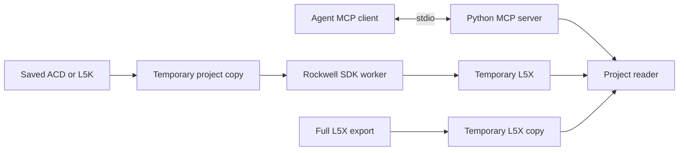

# Architecture

The MCP client launches `logix-project-mcp` with a project path chosen by the user. The server resolves and validates the path at startup. Inspection tools use that baseline for the life of the process. The optional `--compare-project` path selects a second saved project for comparison.

- `server.py` validates tool arguments and serializes reads, comparisons, and exports for the selected project. Each successful inspection response includes the source snapshot's SHA-256. The [MCP tool contract](mcp-contract.md) describes capability discovery and error metadata.
- `inventory.py` extracts scoped tag and routine identities and component metadata from the verified L5X snapshot.
- `routines.py` extracts numbered source text, diagram structure, and protection status from saved routines.
- `search.py` indexes visible declarations by scope, resolves references from saved routine sections, and produces bounded search pages.
- `comparison.py` normalizes the two L5X projections, matches components by name and scope, and emits XML and readable source diffs.
- `project.py` copies the selected source into a per-read temporary directory and checks the file identity, size, modification time, and copied bytes before using the snapshot. Each request starts from the saved file at the selected path.
- Native reads use an SDK subprocess to convert the snapshot to L5X. It keeps Rockwell runtime output off MCP stdio. Cancellation and the export timeout stop and reap the worker before the temporary directory is removed and the next read begins.
- `_sdk_worker.py` calls Rockwell's Python SDK from Windows to open the snapshot and create full or component exports. The SDK installation and activation belong to the host machine.
- `export.py` stages the copied source and SDK output in a temporary directory under the configured export directory. It checks the artifact before creating the destination atomically with an operation that rejects an existing entry, including one created while the SDK is running.
- Inspection requires a full project export. The XML parser keeps project text and comments as data and rejects DTD declarations.

Studio 5000 keeps unsaved edits in its editor working copy. A future Tools menu integration can pass the current project path to a local helper. Any workflow that applies changes needs a separate design for revisions, review, and writing to a new project file or importing a change into Studio 5000.
