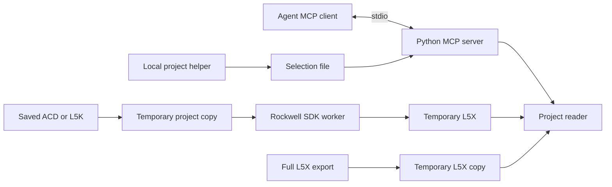

# Architecture

The MCP client launches `logix-project-mcp` with a fixed `--project` path or a shared `--selection-file` path chosen by the user. In shared mode the local helper validates a saved project and atomically publishes its path and selection ID. The server captures that selection once per request. The optional `--compare-project` path selects a second saved project for comparison.

- `server.py` validates tool arguments and serializes reads, comparisons, and exports for the selected project. Each successful inspection response includes the source snapshot's SHA-256. The [MCP tool contract](mcp-contract.md) describes capability discovery and error metadata.
- `share.py` provides the local command and Windows dialogs. `selection.py` validates and atomically publishes the selected path. In shared mode each successful project response records the selection ID captured for that request.
- `custom_tools.py` installs, updates, and removes the sharing command in Logix Designer's existing menu configuration, with a backup on each actual change.
- `inventory.py` extracts scoped tag and routine identities and component metadata from the verified L5X snapshot.
- `routines.py` extracts numbered source text, diagram structure, and protection status from saved routines.
- `search.py` indexes visible declarations by scope, resolves references from saved routine sections, and produces bounded search pages.
- `comparison.py` normalizes the two L5X projections, matches components by name and scope, and emits XML and readable source diffs.
- `proposals.py` creates typed documentation-only previews from a read snapshot. It binds the source identity, normalized targets, operations, and before/after values to a deterministic digest. Validation rebuilds the preview from the current snapshot and checks the independently retained digest. Neither operation writes project files.
- `documentation.py` uses parser-verified byte ranges to stage a new full UTF-8 L5X documentation copy. It verifies the proposal again, checks the staged descriptions and artifact bytes, rechecks source and selection, and publishes without overwriting another file. No routine logic, data values, or native projects are edited.
- The read-only documentation verifier reconstructs the expected output and compares exact bytes against a separately retained artifact fingerprint. Both source and artifact snapshots and the selection are rechecked before returning.
- `project.py` copies the selected source into a per-read temporary directory and checks the file identity, size, modification time, and copied bytes before using the snapshot. Each request starts from the saved file at the selected path.
- Native reads use an SDK subprocess to convert a new snapshot to L5X. It keeps Rockwell runtime output off MCP stdio. Cancellation and the export timeout stop and reap the worker before the temporary directory is removed and the next read begins.
- Each MCP session retains up to four validated native XML exports with a combined 128 MiB byte budget. The cache key combines the selected path and the verified source SHA-256, and entries are evicted least-recently-used. Every read still verifies the saved source and parses its selected XML into a fresh tree. The cache lives in memory for the lifetime of the server process.
- `_sdk_worker.py` calls Rockwell's Python SDK from Windows to open the snapshot and create full or component exports. The SDK installation and activation belong to the host machine.
- `export.py` stages the copied source and SDK output in a temporary directory under the configured export directory. It checks the artifact before creating the destination atomically with an operation that rejects an existing entry, including one created while the SDK is running.
- Inspection requires a full project export. The XML parser keeps project text and comments as data and rejects DTD declarations.

Studio 5000 keeps unsaved edits in its editor working copy. The verified [Custom Tools integration](studio-5000-integration.md) passes the active editor's saved project path to a local helper. The selection and refresh workflow builds on this path and the existing verified snapshot. Any workflow that applies changes needs a separate design for revisions, review, and writing to a new project file or importing a change into Studio 5000.
