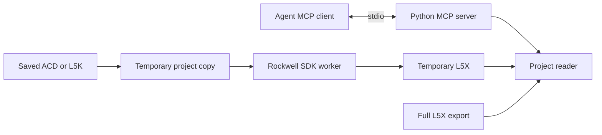

# Architecture

The MCP client launches `logix-project-mcp` with a project path chosen by the user. The server resolves and validates the path at startup. All tools operate on that project for the life of the server process.

- `server.py` defines the MCP tool contracts and serializes reads for the selected project. Each call reads the current saved version.
- `project.py` parses the common L5X representation. Native reads use a temporary copy and an SDK subprocess. The subprocess isolates Rockwell runtime initialization and output from MCP stdio. Its execution is bounded so a stalled conversion can return a tool error.
- `_sdk_worker.py` calls Rockwell's Python SDK from Windows to open the snapshot and save a detailed L5X export. The SDK installation and activation belong to the host machine.
- The parser requires a full project export. It keeps project text and comments as data and rejects DTD declarations.

Studio 5000 keeps unsaved edits in its editor working copy. A future Tools menu integration can pass the current project path to a local helper. Any workflow that applies changes needs a separate design for revisions, review, and writing to a new project file or importing a change into Studio 5000.
